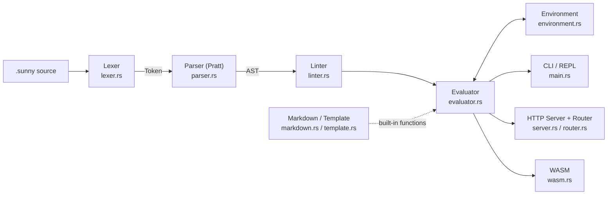

English | [繁體中文](README.zh-TW.md)

# ☀️ Sunny Lang

> A programming language built in Rust: immutable by default, `Shadow` instead of exceptions, and a documentation site written in the language itself.

[](https://github.com/AdaaWu/sunny-lang/actions/workflows/deploy.yml)
[](https://adaawu.github.io/sunny-lang/)
[](https://adaawu.github.io/sunny-lang/playground/)
[](LICENSE)

Sunny is a small, statically-linted programming language implemented from scratch in Rust (no parser generators): lexer, Pratt parser, AST, tree-walking evaluator, REPL, and a linter that enforces naming conventions. Errors are values (`Shadow`) rather than exceptions, bindings are immutable by default (`lit`) with opt-in mutability (`glow`), and functions named `xxxIndex/Show/Store/Update/Remove` are auto-mapped to HTTP routes. The same evaluator compiles to WebAssembly and powers an in-browser playground, and the official docs site is generated by a Sunny program (`site/site.sunny`) using the language's own Markdown and template engines. It is deployed to GitHub Pages by GitHub Actions. The repo has 180 passing unit tests.

## Try It Online

- Docs site (generated by Sunny itself): <https://adaawu.github.io/sunny-lang/>
- Online Playground (the evaluator compiled to WASM, running in your browser): <https://adaawu.github.io/sunny-lang/playground/>
- Source code: <https://github.com/AdaaWu/sunny-lang>

## Features

- **`lit` / `glow` bindings**: `lit` is an immutable constant; only `glow` allows reassignment. Immutability is enforced at runtime by `Environment`.
- **Shadow instead of exceptions**: no try/catch and no panics. A function that can fail returns `T | Shadow`, and the caller handles it with `match`. Shadow also has chainable methods such as `wrap` and `unwrap_or`. Division by zero returns a Shadow too.
- **Union type annotations**: `-> String | Shadow`, used together with `match` type branches of the form `is Type name ->`.
- **`ray { }` concurrency blocks**: in the native build they run on a new thread and return a handle; use `await()` to get the result.
- **Resource Action Linter**: top-level named functions must end in `index` / `show` / `store` / `update` / `remove` (except `SCREAMING_SNAKE_CASE` names and anonymous closures) and must be camelCase; otherwise they are rejected before execution.
- **Automatic route mapping**: `fn productIndex()` maps to `GET /product`, with a built-in HTTP server (`sun serve`).
- **Everyday language features**: string interpolation `"Hi, {name}!"`, `while`, range loops `for x in 0..10`, closures `fn(x) { ... }`, `import` modules, built-in List / Map / String methods, and `//` and `/* */` comments.
- **Self-hosted docs**: the docs site is built by `site/site.sunny`, which reads Markdown, renders it, applies templates and writes the HTML. The whole pipeline is a Sunny program.
- **Tooling**: REPL, WASM Playground, and a VS Code syntax-highlighting extension (`editors/vscode/sunny-lang/`).

## Code Example

Excerpted from [`examples/hello.sunny`](examples/hello.sunny) (with a `ray` example added) and verified by running it with `sun`:

```sunny
lit name = "Sunny"
print("Welcome to " + name + " Lang!")

fn dataShow(id: Int) -> String | Shadow {
    if id < 0 {
        out Shadow("ID must be positive")
    }
    out "Valid Data"
}

lit bad = dataShow(-1)
match bad {
    is String val -> print("Success:", val)
    is Shadow s -> print("Error:", s.message)
}

lit handle = ray {
    out 1 + 2
}
print("ray:", await(handle))
```

Output:

```text
Welcome to Sunny Lang!
Error: ID must be positive
ray: 3
```

## Architecture



`src/lib.rs` packages the core as a library crate, while `src/main.rs` is just the CLI entry point (the binary is named `sun`). `router` and `server` belong to the `native` feature (which depends on `tiny_http`), and the `wasm` module belongs to the `wasm` feature (which depends on `wasm-bindgen`), so the same core serves both native and browser targets.

| Module | Responsibility |
|--------|----------------|
| `token.rs` | Token enum and keyword resolution via `lookup_ident()` |
| `lexer.rs` | Character-by-character scanner; supports `//` and `/* */` comments and single- or double-quoted strings |
| `ast.rs` | `Statement` / `Expression` nodes and type annotations (including Union) |
| `parser.rs` | Pratt parsing with 9 operator precedence levels |
| `linter.rs` | Pre-execution static checks: Resource Action suffixes and camelCase |
| `environment.rs` | Scope chain with an `outer` pointer, `lit` / `glow` rules, and the `Value` type |
| `evaluator.rs` | Tree-walking evaluation, Shadow propagation, `ray`, `import`, and built-in functions |
| `markdown.rs` | Built-in Markdown to HTML renderer |
| `template.rs` | `{{ key }}` template engine |
| `router.rs` | Derives HTTP routes from function names and matches paths |
| `server.rs` | HTTP server built on `tiny_http` |
| `wasm.rs` | wasm-bindgen interface for `eval_sunny()` / `tokenize_sunny()` |
| `lib.rs` / `main.rs` | Library exports / CLI and REPL |

## Getting Started

Requires the Rust toolchain (edition 2021).

```bash
# Build
cargo build --release

# Run a file
cargo run -- examples/hello.sunny      # or ./target/release/sun examples/hello.sunny

# REPL (no arguments; exit with Ctrl+D)
cargo run

# Test
cargo test

# Start the Sunny-powered HTTP server (default port 3000)
cargo run -- serve examples/server.sunny
# Also available: sun restart <file> [port] and sun stop [port]
```

**Build the docs site** (same flow as CI; writes to `dist/`):

```bash
cargo build --release
./target/release/sun site/site.sunny   # generate dist/*.html with Sunny
cp -r playground/ dist/playground/
```

**Run the Playground locally**: requires [`wasm-pack`](https://rustwasm.github.io/wasm-pack/) and a build with the `wasm` feature that outputs to `playground/pkg/` (this directory is listed in `.gitignore`).

```bash
wasm-pack build --target web --out-dir playground/pkg -- --no-default-features --features wasm
cd playground && python3 -m http.server   # then open http://localhost:8000 in your browser
```

> Playground limitations: it runs entirely in the browser, so file I/O and HTTP server features return a `Shadow` there, and `ray` blocks run synchronously.

## Project Structure

```text
sunny-lang/
├── src/                  # Language implementation (see the module table above)
├── examples/             # hello.sunny, server.sunny, docs/
├── site/
│   ├── site.sunny        # Docs generator written in Sunny
│   ├── pages/*.md        # Docs content (index, tutorial, syntax, types, builtins, shadow, server, playground)
│   ├── layouts/          # HTML templates
│   └── static/           # Static assets
├── playground/           # Pure static frontend (index.html, runner.js, syntax.js, examples.js, style.css)
├── editors/vscode/sunny-lang/   # VS Code syntax-highlighting extension
├── .github/workflows/deploy.yml # Test → build → generate docs → deploy to GitHub Pages
├── SPEC.md / STEP.md     # Language spec and development plan
├── ROADMAP.md            # Self-hosted Playground roadmap (Phases 5–9)
└── Cargo.toml
```

## Roadmap Status

| Item | Status |
|------|--------|
| M1 Core engine: Lexer → Parser → AST → Evaluator → Linter → REPL | Done |
| M2 Data and safety: List / Map / String methods, Shadow error chaining | Done |
| M3 Backend power: `ray`, automatic route mapping, HTTP server, `serve` / `restart` / `stop` | Done |
| M4 Self-sufficiency: Markdown rendering, template engine, docs system | Done |
| Language enhancements: range loops, closures, `import`, string interpolation, `while` | Done |
| WASM build and Playground frontend | Implemented (`src/wasm.rs`, `playground/`) |
| Self-hosted docs site and GitHub Pages deployment | Implemented (`site/site.sunny`, `deploy.yml`) |

Phases 5–9 in ROADMAP.md (language improvements, WASM, Playground, self-hosted docs, deployment) are the plan for the second half of the table above; M1–M4 correspond to the four-month schedule in STEP.md.

## Testing

`cargo test` currently runs 180 unit tests (in the modules under `src/lib.rs`), and all of them pass.

## License

This project is licensed under the [MIT License](LICENSE). Copyright (c) 2026 Sunny.cat.
