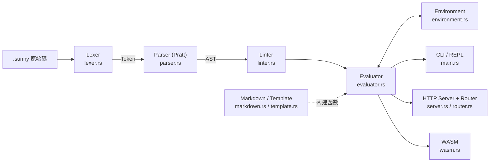

[English](README.md) | 繁體中文

# ☀️ Sunny Lang

> 一門以 Rust 打造的程式語言：預設不可變、用 `Shadow` 取代例外、並且用自己寫自己的文檔網站。

[](https://github.com/AdaaWu/sunny-lang/actions/workflows/deploy.yml)
[](https://adaawu.github.io/sunny-lang/)
[](https://adaawu.github.io/sunny-lang/playground/)
[](LICENSE)

## 線上體驗

- 文檔網站（由 Sunny 自己產生）：<https://adaawu.github.io/sunny-lang/>
- 線上 Playground（Evaluator 編譯成 WASM，在瀏覽器執行）：<https://adaawu.github.io/sunny-lang/playground/>
- 原始碼：<https://github.com/AdaaWu/sunny-lang>

## 特色

- **`lit` / `glow` 綁定**：`lit` 為不可變常數，`glow` 才允許重新賦值；不可變性由 `Environment` 在執行時強制檢查。
- **Shadow 取代例外**：沒有 try/catch，也不 panic。可能失敗的函數回傳 `T | Shadow`，呼叫端用 `match` 處理；Shadow 還有 `wrap`、`unwrap_or` 等鏈式方法。除以零同樣回傳 Shadow。
- **聯合型別標註**：`-> String | Shadow`，搭配 `match` 的 `is Type 名稱 ->` 型別分支。
- **`ray { }` 併發區塊**：在原生版本中以新執行緒執行，回傳 handle，用 `await()` 取得結果。
- **Resource Action Linter**：頂層具名函數必須以 `index` / `show` / `store` / `update` / `remove` 結尾（`SCREAMING_SNAKE_CASE` 與匿名閉包除外），且須為 camelCase，否則執行前即被攔截。
- **自動路由映射**：`fn productIndex()` 對應 `GET /product`，內建 HTTP Server（`sun serve`）。
- **語言本身的功能**：字串內插 `"Hi, {name}!"`、`while`、`for x in 0..10` 範圍迴圈、閉包 `fn(x) { ... }`、`import` 模組、List / Map / String 內建方法、`//` 與 `/* */` 註解。
- **自舉文檔**：文檔網站由 `site/site.sunny` 讀取 Markdown、渲染、套用模板並寫出 HTML——整個流程都是 Sunny 程式。
- **周邊工具**：REPL、WASM Playground、VS Code 語法高亮擴充（`editors/vscode/sunny-lang/`）。

## 程式碼範例

節錄自 [`examples/hello.sunny`](examples/hello.sunny)（加上 `ray` 範例），已實際以 `sun` 執行驗證：

```sunny
lit name = "Sunny"
print("Welcome to " + name + " Lang!")

fn dataShow(id: Int) -> String | Shadow {
    if id < 0 {
        out Shadow("ID must be positive")
    }
    out "Valid Data"
}

lit bad = dataShow(-1)
match bad {
    is String val -> print("Success:", val)
    is Shadow s -> print("Error:", s.message)
}

lit handle = ray {
    out 1 + 2
}
print("ray:", await(handle))
```

輸出：

```text
Welcome to Sunny Lang!
Error: ID must be positive
ray: 3
```

## 架構



`src/lib.rs` 把核心打包成 library crate，`src/main.rs` 只是 CLI 入口（二進位名稱為 `sun`）。`router` 與 `server` 屬於 `native` feature（依賴 `tiny_http`），`wasm` 模組屬於 `wasm` feature（依賴 `wasm-bindgen`），因此同一份核心可同時給原生與瀏覽器使用。

| 模組 | 職責 |
|------|------|
| `token.rs` | Token 列舉與關鍵字解析 `lookup_ident()` |
| `lexer.rs` | 逐字元掃描器，支援 `//`、`/* */` 註解與單／雙引號字串 |
| `ast.rs` | `Statement` / `Expression` 節點與型別標註（含 Union） |
| `parser.rs` | Pratt Parsing，9 級運算子優先級 |
| `linter.rs` | 執行前靜態檢查：Resource Action 後綴與 camelCase |
| `environment.rs` | 帶 `outer` 指標的作用域鏈、`lit` / `glow` 規則、`Value` 型別 |
| `evaluator.rs` | Tree-walking 求值、Shadow 傳遞、`ray`、`import`、內建函數 |
| `markdown.rs` | 內建 Markdown → HTML 渲染器 |
| `template.rs` | `{{ key }}` 模板引擎 |
| `router.rs` | 由函數名稱推導 HTTP 路由並做路徑匹配 |
| `server.rs` | 基於 `tiny_http` 的 HTTP Server |
| `wasm.rs` | `eval_sunny()` / `tokenize_sunny()` 的 wasm-bindgen 介面 |
| `lib.rs` / `main.rs` | library 匯出 / CLI 與 REPL |

## 快速開始

需要 Rust 工具鏈（edition 2021）。

```bash
# 建置
cargo build --release

# 執行檔案
cargo run -- examples/hello.sunny      # 或 ./target/release/sun examples/hello.sunny

# REPL（不帶參數；Ctrl+D 離開）
cargo run

# 測試
cargo test

# 啟動由 Sunny 驅動的 HTTP Server（預設 port 3000）
cargo run -- serve examples/server.sunny
# 另有 sun restart <file> [port] 與 sun stop [port]
```

**建置文檔網站**（與 CI 相同流程；會寫入 `dist/`）：

```bash
cargo build --release
./target/release/sun site/site.sunny   # 以 Sunny 產生 dist/*.html
cp -r playground/ dist/playground/
```

**在本機執行 Playground**：需要 [`wasm-pack`](https://rustwasm.github.io/wasm-pack/)，並以 `wasm` feature 編譯出 `playground/pkg/`（此目錄已列入 `.gitignore`）。

```bash
wasm-pack build --target web --out-dir playground/pkg -- --no-default-features --features wasm
cd playground && python3 -m http.server   # 瀏覽器開啟 http://localhost:8000
```

> Playground 限制：完全在瀏覽器內執行，檔案 I/O 與 HTTP server 功能會回傳 `Shadow`，`ray` 區塊在此以同步方式執行。

## 專案結構

```text
sunny-lang/
├── src/                  # 語言實作（見上方模組表）
├── examples/             # hello.sunny、server.sunny、docs/
├── site/
│   ├── site.sunny        # 用 Sunny 寫的文檔產生器
│   ├── pages/*.md        # 文檔內容（index、tutorial、syntax、types、builtins、shadow、server、playground）
│   ├── layouts/          # HTML 模板
│   └── static/           # 靜態資源
├── playground/           # 純靜態前端（index.html、runner.js、syntax.js、examples.js、style.css）
├── editors/vscode/sunny-lang/   # VS Code 語法高亮擴充
├── .github/workflows/deploy.yml # 測試 → 建置 → 產生文檔 → 部署 GitHub Pages
├── SPEC.md / STEP.md     # 語言規格與開發進度規劃
├── ROADMAP.md            # 自舉 Playground 路線圖（Phase 5–9）
└── Cargo.toml
```

## Roadmap 狀態

| 項目 | 狀態 |
|------|------|
| M1 核心引擎：Lexer → Parser → AST → Evaluator → Linter → REPL | 完成 |
| M2 資料與安全：List / Map / String 方法、Shadow 錯誤鏈 | 完成 |
| M3 後端動力：`ray`、自動路由映射、HTTP Server、`serve` / `restart` / `stop` | 完成 |
| M4 自給自足：Markdown 渲染、模板引擎、文檔系統 | 完成 |
| 語言增強：範圍迴圈、閉包、`import`、字串內插、`while` | 完成 |
| WASM 編譯與 Playground 前端 | 已實作（`src/wasm.rs`、`playground/`） |
| 文檔網站自舉與 GitHub Pages 部署 | 已實作（`site/site.sunny`、`deploy.yml`） |

ROADMAP.md 內的 Phase 5–9（語言補強、WASM、Playground、文檔自舉、部署）即是上述後半部的規劃；M1–M4 對應 STEP.md 的四個月進度表。

## 測試

`cargo test` 目前執行 180 個單元測試（`src/lib.rs` 內各模組），全數通過。

## 授權

本專案以 [MIT License](LICENSE) 授權。Copyright (c) 2026 Sunny.cat。
